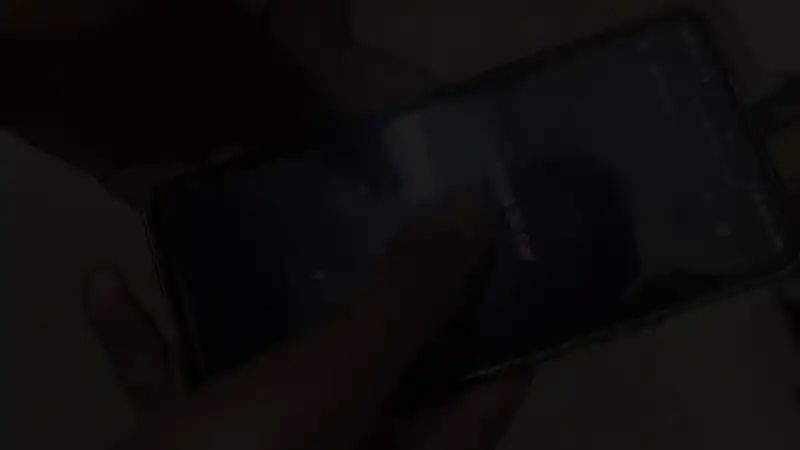

# ESP32 Car — MuJoCo demo



Virtual lap environment that matches your real build and `car.ino` controls:

- **Body:** 4 DC gear motors, dual Li-ion pack (series), L298N driver, ESP32 on top
- **Track:** Oval asphalt lap with kerbs, start/finish, arch, and cones
- **Controls:** Same as the phone UI — ▲ forward, ▼ back, ◀ / ▶ turn, ■ stop

## Run

From the project folder:

```powershell
.\venv\Scripts\python.exe sim\drive.py
```

Two windows open:

1. **MuJoCo 3D** — chase camera follows the car; use arrow keys or WASD (tap Space to stop)
2. **Control pad** — hold buttons like on your phone (release = stop)

## Files

| File | Purpose |
|------|---------|
| `assets/esp32_car.xml` | Car model + wheel velocity actuators |
| `assets/race_track.xml` | Track scene (includes car) |
| `drive.py` | Simulation loop and control mapping |

**Forward / back:** all four wheels same speed (moderate). **Left / right:** differential drive — inner side slow, outer side faster (smooth arc, no tire folding). Your real `car.ino` still uses pivot steering on the hardware; the sim uses this physics-friendly mix for stable turns.
